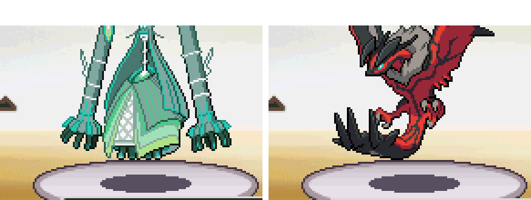

# Battle sprite review (#494–1025)

Claude B, 2026-10-26. Each sprite below looks wrong, or likely wrong, in a battle in the test build.

**What was checked:** every species #494–1025 in a wild battle, with the same species as the player's lead. That
gives its front and back, normal and shiny: 1,064 battles. The build was **PR #157** (PokeAPI fronts, front and back
palettes of their own). A sample of every 8th species of #1–493 was checked too. The tool is
`tools/test/sprite_check.py`. All the battles ran; none hung.

## Wrong in game

| # | Pokémon | Sprite | Problem | Before #157 too? | Fix |
|---|---|---|---|---|---|
| 503 | Samurott | front, both shinies | **Scrambled in battle**: noise over the whole sprite | no: PR #157's PokeAPI front | **fixed** (see "Scrambled sprites") |
| 663 | Talonflame | back, both shinies | **Scrambled in battle** | **yes** | **fixed** |
| 933 | Naclstack | back, shiny back | **Bulbasaur's back** (the pack's placeholder) | yes, the front too | needs art |
| 946 | Bramblin | back, shiny back | **Bulbasaur's back** | yes, the front too | needs art |
| 947 | Brambleghast | back, shiny back | **Bulbasaur's back** | yes, the front too | needs art |
| 989 | Sandy Shocks | back, shiny back | **Bulbasaur's back** | yes, the front too | needs art |
| 992 | Iron Hands | back, shiny back | **Bulbasaur's back** | yes, the front too | needs art |
| 1010 | Iron Leaves | back, shiny back | **Bulbasaur's back** | yes, the front too | needs art |
| 1015 | Munkidori | back, shiny back | **Bulbasaur's back** | yes, the front too | needs art |
| 1023 | Iron Crown | back, shiny back | **Bulbasaur's back** | yes, the front too | needs art |
| 1024 | Terapagos | back, shiny back | **Bulbasaur's back** | yes, the front too | needs art |
| 666 | Vivillon | back, shiny back | The back has white wings (another pattern); PokeAPI's front is the pink Meadow pattern | the front was white too | a Meadow back, or the pack's front |
| 669 | Flabébé | shiny front | Patchy: white holes, parts missing | no | see "Shinies drawn apart" |
| 670 | Floette | shiny front | Patchy: white holes, a black outline in places | no | see "Shinies drawn apart" |
| 671 | Florges | shiny front | Washed out: the head is a flat pink | no | see "Shinies drawn apart" |
| 668 | Pyroar | shiny front | A black patch on a back leg | no | lining the shiny up first helps (see "The converter patch") |
| 807 | Zeraora | shiny front | Teal claws: PokeAPI's shiny is drawn 1 pixel off its front | yes (the pack's was too) | lining the shiny up fixes it |
| 1023 | Iron Crown | shiny front | Wrong colours throughout: the shiny is drawn 1 pixel off | no | lining the shiny up fixes it |

### Scrambled sprites (Samurott, Talonflame)

The game unscrambles each battle sprite with a key it takes from the sprite's own first four pixels
(`PokemonSprite_DecryptPt`). That only works when those pixels are clear. Two sprites draw into that corner:
- Samurott's PokeAPI front: its horn tip.
- Talonflame's back: a wing tip. It was scaled to 88% to fit 80×80.

Either comes out as noise. Clearing those few pixels (1 for Samurott, 2 for Talonflame) fixes both. The converter
fix and a CI check (`tools/test/check_battle_sprites.py`) are in: the converters clear those pixels (Hisuian
Samurott's front, from PR #159, needed it too), and CI fails on any battle sprite that draws there.

### Bulbasaur's back (9 species)

In `assets/sprites/packs/gen5_9_part1`, the folders of these 9 species hold the same four 80×80 files: Bulbasaur's.
PR #157 replaces their fronts and shiny fronts with PokeAPI's, but their backs and shiny backs are still
Bulbasaur's. The Smogon Gen 9 sheet (`assets/sprites/credits/smogon/gen9.csv`) has fronts for 7 of them but **no
backs for any**, so new art is needed.

### Shinies drawn apart (PokeAPI)

For some species, PokeAPI's shiny front is a different drawing from its front: another pose or angle, not a
recolour. The game can only recolour the front, so these shinies can only be approximate.
- **Shiny colours:** the converter takes each shiny colour from the pixel at the same spot in the shiny sprite.
  Where the drawings differ, it picks up the wrong colours.
- **What I tried:**
  - Lining each shiny up on its front fixes 4 of PR #157's 11, Pyroar's among them.
  - Two other approaches made things worse. One copied colours from the pack's shinies, which are estimates for these
    species. The other read colours only from pixels inside both shapes.
- **Still approximate:** Flabébé, Floette, Florges, Vivillon, Smoliv and Toedscruel. Smoliv and Toedscruel look
  close; Flabébé and Floette look broken.
- **Options:**
  - Use the pack's front and shiny front for these 6.
  - Hand-pick their shiny palettes.
  - Accept them as they are.

Floette's PokeAPI front is also an odd drawing, with a flat flower at another angle (see the image above). It may be
worth replacing too.

## Forms (PR #159's fronts)

`sprite_check.py --forms` battled each of the 368 forms with a front of its own (736 battles, none hung).
- **Fronts:** they all look right and sit right. The one exception was Hisuian Samurott's front, which was scrambled
  like Samurott's; it is fixed now (#162).
- **Backs:** a form's back is still its species' back. That's known: there's no back art for forms yet. It shows
  most where a form looks different from behind, such as the Galarian birds, Galarian Rapidash, the Vivillon
  patterns and the regional forms.
- **Fronts not seen here:** some forms change back when the battle starts, as in the games, so their own fronts
  didn't show in this check:
  - Minior's cores show the Meteor shell (Shields Down).
  - Hangry Morpeko shows Full Belly.
  - Gulping and Gorging Cramorant show plain Cramorant.
  - Blade Aegislash shows its Shield Forme.
  - Busted Mimikyu shows its disguise.

`battle_form_changes.py` covers those changes in battle.

## The 96×96 fronts (2026-10-29)

`sprite_check.py` again, on the 96×96 fronts build (`docs/FrontSprites96.md`): every species #494–1025, normal
and shiny (1,064 battles), and with `--forms` the 376 forms with a front of their own (752 battles). None hung. Every
front is whole and stands on its platform. The backs are as above (the 9
Bulbasaur backs, Reshiram's lavender back, Vivillon's pattern). Two things are new:

**Tall fronts reach above the screen (owner's call).** A front's y offset puts its feet on the platform, and
Platinum's 80×80 box then always stayed at least 2 pixels below the top of the screen. A 96×96 box is 8 rows taller,
so a tall front whose feet reach its bottom row now starts above the screen, and its top rows are cut. Platinum
places the foe's sprite centre at y 50, and the second foe of a double battle at y 42:
- **Singles (and the first foe in doubles):** 49 fronts lose up to 6 rows. 6 rows: Buzzwole, Celesteela, Raging
  Bolt, Xerneas (both modes), Xurkitree, Yveltal, Complete Zygarde, Dusk Mane Necrozma, and the Megas of Barbaracle,
  Baxcalibur, Blaziken, Chandelure, Crabominable, Emboar, Glimmora, Golurk, Malamar, Pyroar, Rayquaza, Scolipede and
  Victreebel. 5 or fewer: Mega Diancie, Alolan Exeggutor, Black Kyurem, Crowned Zacian, Hisuian Braviary, Mega
  Froslass, Koraidon, Sirfetch'd, Mega Staraptor, Mega Drampa, Overqwil, Galarian Weezing, Mega Altaria, Origin
  Dialga, Hoopa Unbound, Pheromosa, Stakataka, Ho-Oh, Kingambit, White Kyurem, Mega Meganium, Dawn Wings Necrozma,
  Sigilyph, Wyrdeer and Zekrom.
- **The second foe of a double battle:** 119 fronts lose up to 14 rows.
- The choices: keep the cut; move such a front down until its top is on screen, so its feet sit up to 6 pixels
  lower on the platform (14 for the second foe in doubles); or shrink only these fronts.

**Art cut at the 96×96 box's edge.** A scan of every 96×96 front for art on its top, left or right edge finds 50. Most
only touch the edge (a flame, a tail tip), as some of Black and White's own sprites do (Lugia, Zekrom). These are cut:

| Pokémon | Where |
|---|---|
| Mega Rayquaza | its body on the left, its whiskers at the top |
| Noivern | both wingtips |
| Mega Metagross | both arms |
| Mega Staraptor | both wingtips |
| Xerneas (Active Mode) | the tips of its antlers |
| Yveltal | the tops of its wings |
| Mega Diancie | the sides of its veil |
| White Kyurem | its right wing |

They need art drawn to fit 96×96 (E12). The 80×80 build shrank the same art, so they were cut there too.

## Likely wrong, worth a look

| # | Pokémon | Sprite | What I see |
|---|---|---|---|
| 643 | Reshiram | back | Lavender, though its front is white. This back was generated from the shiny back (below) |
| 720 | Hoopa | back | 18% of its colours sit nearer the shiny front's colours than the front's. It looks fine by eye |

**Generated backs:** the pack's `relabel_manifest.csv` says the owner's relabel tool *generated* **364 normal
backs** from the shiny backs. Many have a low confidence score (as low as 0.08 for Aurorus and Yveltal). I compared
each generated back's colours with PokeAPI's real front and shiny front. Apart from the ones flagged above, none
leans toward the shiny colours. So the estimates look sound, but they are estimates, not drawn art.

## Not wrong, for the record

- **Positions:** fronts and backs sit right in battle, the scaled ones included (103 fronts and 24 backs).
- **#1–493:** the sample looks as before. Their back palettes are copies of the front ones (#157).
- **Female sprites:** Unfezant, Frillish, Jellicent and Pyroar show their male sprite when female. This is known.
- **Long names:** names over 10 characters are cut short (BLACEPHALN). This is by design (`docs/NewSpecies.md`).

## The converter patch: lining shinies up (after PR #161)

PR #161 (Claude A) picks shiny palettes from (normal, shiny) colour pairs. That covers my split entries and rounding
fix. What the patch adds on top: before a shiny's colours are read, the shiny is moved by up to 3 pixels to best cover
its front's shape (`line_up`), so a shiny drawn a pixel off no longer swaps outline and body colours.

Measured on #161's sprites: the share of each shiny's pixels that come out in their source colour.

| | Exact | Under 90% | Mean |
|---|---|---|---|
| Fronts (532), before → after | 505 → 506 | 12 → 9 | 98.1% → 98.7% |
| Form fronts (414), before → after | 351 → 352 | 35 → 34 | 95.6% → 95.8% |
| Backs (532) | unchanged | | |

- **Fixed or much better:**
  - Iron Crown: 0% → 100%.
  - Zeraora: 18% → 100%.
  - Galarian Darumaka: 25% → 100%.
  - Furfrou: 57% → 99%.
  - Ting-Lu: 34% → 81%.
  - Pyroar: 10% → 40%.
  - Female Meowstic: 20% → 38%.
- **Not helped:**
  - The shinies drawn apart (above).
  - The forms with more than 15 colours (Furfrou's trims, several new Megas). Their colour pairs are grouped by
    k-means, so few pixels keep their exact colour. They look right; the measure is strict.
- **When:** it ships once #161 is merged. 13 sprite folders change.
