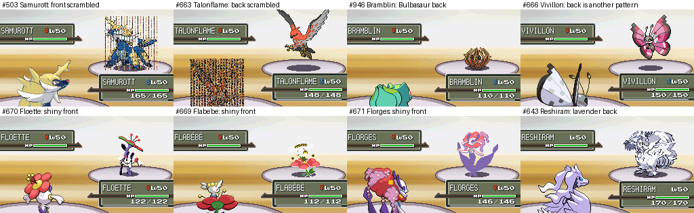

# Battle sprite review (#494–1025)

Claude B, 2026-10-26. Each sprite below looks wrong, or likely wrong, in a battle in the test build.

**What was checked:** every species #494–1025 in a wild battle, with the same species as the player's lead. That
gives its front and back, normal and shiny: 1,064 battles. The build was **PR #157** (PokeAPI fronts, front and back
palettes of their own). A sample of every 8th species of #1–493 was checked too. The tool is
`tools/test/sprite_check.py`. All the battles ran; none hung.

## Wrong in game

| # | Pokémon | Sprite | Problem | Before #157 too? | Fix |
|---|---|---|---|---|---|
| 503 | Samurott | front, both shinies | **Scrambled in battle**: noise over the whole sprite | no: PR #157's PokeAPI front | **fixed** (see "Scrambled sprites") |
| 663 | Talonflame | back, both shinies | **Scrambled in battle** | **yes** | **fixed** |
| 933 | Naclstack | back, shiny back | **Bulbasaur's back** (the pack's placeholder) | yes, the front too | needs art |
| 946 | Bramblin | back, shiny back | **Bulbasaur's back** | yes, the front too | needs art |
| 947 | Brambleghast | back, shiny back | **Bulbasaur's back** | yes, the front too | needs art |
| 989 | Sandy Shocks | back, shiny back | **Bulbasaur's back** | yes, the front too | needs art |
| 992 | Iron Hands | back, shiny back | **Bulbasaur's back** | yes, the front too | needs art |
| 1010 | Iron Leaves | back, shiny back | **Bulbasaur's back** | yes, the front too | needs art |
| 1015 | Munkidori | back, shiny back | **Bulbasaur's back** | yes, the front too | needs art |
| 1023 | Iron Crown | back, shiny back | **Bulbasaur's back** | yes, the front too | needs art |
| 1024 | Terapagos | back, shiny back | **Bulbasaur's back** | yes, the front too | needs art |
| 666 | Vivillon | back, shiny back | The back has white wings (another pattern); PokeAPI's front is the pink Meadow pattern | the front was white too | a Meadow back, or the pack's front |
| 669 | Flabébé | shiny front | Patchy: white holes, parts missing | no | see "Shinies drawn apart" |
| 670 | Floette | shiny front | Patchy: white holes, a black outline in places | no | see "Shinies drawn apart" |
| 671 | Florges | shiny front | Washed out: the head is a flat pink | no | see "Shinies drawn apart" |
| 668 | Pyroar | shiny front | A black patch on a back leg | no | lining the shiny up first fixes it (see "The converter patch") |

### Scrambled sprites (Samurott, Talonflame)

The game unscrambles each battle sprite with a key it takes from the sprite's own first four pixels
(`PokemonSprite_DecryptPt`). That only works when those pixels are clear. Two sprites draw into that corner:
- Samurott's PokeAPI front: its horn tip.
- Talonflame's back: a wing tip. It was scaled to 88% to fit 80×80.

Either comes out as noise. Clearing those few pixels (1 for Samurott, 2 for Talonflame) fixes both. The converter
fix and a CI check (`tools/test/check_battle_sprites.py`) are in: the converters clear those pixels (Hisuian
Samurott's front, from PR #159, needed it too), and CI fails on any battle sprite that draws there.

### Bulbasaur's back (9 species)

In `assets/sprites/packs/gen5_9_part1`, the folders of these 9 species hold the same four 80×80 files: Bulbasaur's.
PR #157 replaces their fronts and shiny fronts with PokeAPI's, but their backs and shiny backs are still
Bulbasaur's. The Smogon Gen 9 sheet (`assets/sprites/credits/smogon/gen9.csv`) has fronts for 7 of them but **no
backs for any**, so new art is needed.

### Shinies drawn apart (PokeAPI)

For some species, PokeAPI's shiny front is a different drawing from its front: another pose or angle, not a
recolour. The game can only recolour the front, so these shinies can only be approximate.
- **Shiny colours:** the converter takes each shiny colour from the pixel at the same spot in the shiny sprite.
  Where the drawings differ, it picks up the wrong colours.
- **What I tried:**
  - Lining each shiny up on its front fixes 4 of PR #157's 11, Pyroar's among them.
  - Two other approaches made things worse. One copied colours from the pack's shinies, which are estimates for these
    species. The other read colours only from pixels inside both shapes.
- **Still approximate:** Flabébé, Floette, Florges, Vivillon, Smoliv and Toedscruel. Smoliv and Toedscruel look
  close; Flabébé and Floette look broken.
- **Options:**
  - Use the pack's front and shiny front for these 6.
  - Hand-pick their shiny palettes.
  - Accept them as they are.

Floette's PokeAPI front is also an odd drawing, with a flat flower at another angle (see the image above). It may be
worth replacing too.

## Likely wrong, worth a look

| # | Pokémon | Sprite | What I see |
|---|---|---|---|
| 643 | Reshiram | back | Lavender, though its front is white. This back was generated from the shiny back (below) |
| 720 | Hoopa | back | 18% of its colours sit nearer the shiny front's colours than the front's. It looks fine by eye |

**Generated backs:** the pack's `relabel_manifest.csv` says the owner's relabel tool *generated* **364 normal
backs** from the shiny backs. Many have a low confidence score (as low as 0.08 for Aurorus and Yveltal). I compared
each generated back's colours with PokeAPI's real front and shiny front. Apart from the ones flagged above, none
leans toward the shiny colours. So the estimates look sound, but they are estimates, not drawn art.

## Not wrong, for the record

- **Positions:** fronts and backs sit right in battle, the scaled ones included (103 fronts and 24 backs).
- **#1–493:** the sample looks as before. Their back palettes are copies of the front ones (#157).
- **Female sprites:** Unfezant, Frillish, Jellicent and Pyroar show their male sprite when female. This is known.
- **Long names:** names over 10 characters are cut short (BLACEPHALN). This is by design (`docs/NewSpecies.md`).
- **Zeraora:** on main its shiny front has teal claws, because the pack's shiny was drawn 1 pixel off. PR #157
  replaces that front, and its PokeAPI pair lines up.

## The converter patch (still to come)

The rest of the patch waits for PR #161 (Claude A), which picks shiny palettes from (normal, shiny) colour pairs; that
covers my split entries and rounding fix. What it adds on top: lining each shiny up on its front before its colours
are read, which fixes 4 of PokeAPI's 11 shinies that don't line up, Pyroar's among them.
